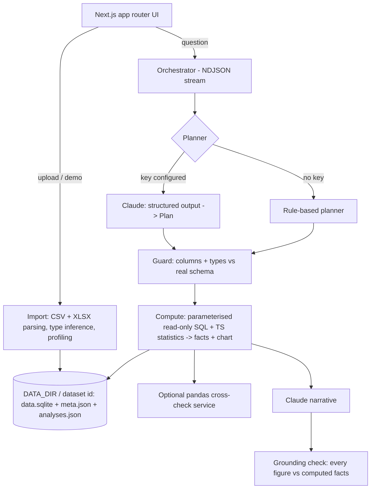

# InsightLab — AI data analyst

Import a CSV or Excel file, check its structure and quality, and ask questions in plain English.
Every answer is **computed from your rows** with read-only SQL and deterministic statistics; when an
Anthropic API key is configured, Claude chooses the analysis and writes an interpretation that is
**checked against the computed numbers** and labelled separately.

Status: **v0.2.0**. See [`PORTFOLIO_STATUS.md`](PORTFOLIO_STATUS.md) for exactly what has been
verified and what has not.

## What it does

| Area | Details |
|---|---|
| Import | Drag-and-drop or file picker with upload progress. CSV/TSV (delimiter, encoding, quoting detection) and Excel `.xlsx` (first non-empty sheet). Type inference per column: numbers (currency, thousands separators, decimal commas, `%`, accounting negatives), dates (ISO, day/month or month/day decided from the data), yes/no, categories, IDs, text. Every assumption is shown. |
| Validation | Size, row and column limits; empty, header-only, malformed, binary, disguised and legacy `.xls` files are rejected with specific messages. Excel archives are checked for decompression bombs before parsing. |
| Explore | Overview with row/column counts, missing cells, duplicate rows and a data-quality panel (missing values, unreadable values, inconsistent spellings, constant columns, negatives where unexpected, outliers). Column drill-down with statistics and distribution charts. Server-paged data browser with sort, full-text search and typed filters. Read-only SQL editor. |
| Ask | Questions become a typed **analysis spec** (aggregate/trend/ranking, distribution, correlation, relationship, describe, outliers, row listing, data quality). A guard checks every column and type against the real schema before anything runs. Results stream back with real progress stages and can be cancelled. |
| Answers | Calculated result (summary + key figures), chart chosen from the result's shape, table, SQL, assumptions, caveats (partial periods, missing groups, truncation), and a step trace. With AI: a labelled interpretation, a grounding check that flags any figure not found in the computed results, and follow-up suggestions. Clarifying questions and honest "cannot answer" replies instead of guesses. |
| Export & persistence | Datasets and conversations are stored on the server for `DATASET_RETENTION_HOURS` (default 24) and survive reloads and restarts; delete them any time. Export tables as CSV, charts as PNG/SVG, and the whole session as a Markdown report. |
| Design | Light and dark themes, responsive layouts down to 375 px, keyboard navigation, visible focus, reduced-motion support, colour-blind-safe validated chart palette. |

## Architecture



```
src/
  app/                 routes: / (import), /datasets/[id] (overview, data, ask, sql), /api/*
  components/          ui primitives, import flow, workspace tabs, analysis thread, charts
  lib/
    config.ts          validated environment configuration (server only)
    ingest/            CSV/XLSX parsing, header normalisation, value parsing and type inference
    profile.ts stats.ts column profiles, quality findings, statistics helpers
    store/             disk-backed dataset store with retention; saved conversations
    query/             SQL builder (quoted identifiers, bound parameters), validator, executor
    analysis/          spec schema, guard, rule planner, Claude planner/narrator, compute, charts, grounding, cross-check
services/analysis/     optional FastAPI pandas sandbox used for cross-checks (Linux/Docker)
```

### How answers stay grounded

1. The planner (Claude or rules) can only return a **typed spec** — never SQL or numbers.
2. The **guard** resolves every column against the real schema, rejects type misuse (e.g. summing text), coerces filter values, and clamps sizes. If Claude names a column that does not exist, it gets one chance to repair the plan.
3. **SQL is generated from the spec** with quoted identifiers and bound parameters, validated as a single read-only SELECT, and run on a connection opened read-only.
4. **Facts** (totals, extremes, changes, shares, correlations…) are computed deterministically and are the only numbers the narrative may use.
5. The **grounding check** extracts every number from the AI text and matches it against facts and table cells, allowing for display rounding; unmatched figures are shown to the user.
6. Failures are shown as failures. If the narrative fails, the computed answer is still shown with a note.

## Run locally

Requirements: Node.js 22 (tested with 22.23). Python is only needed for the optional cross-check service.

```bash
npm ci
```

```bash
cp .env.example .env
```

```bash
npm run dev
```

Open http://localhost:3000 and click **Open demo dataset**, or drop in a file.

Production build:

```bash
npm run build
```

```bash
npm start
```

### Enable Claude

Add your key to `.env` and restart:

```
ANTHROPIC_API_KEY=sk-ant-...
LLM_MODEL=claude-opus-5-5
```

Leave `LLM_PROVIDER` empty (auto) or set it to `anthropic`. Without a key — or with
`LLM_PROVIDER=local` — the app uses the rule-based planner and says so in the UI.
What is sent to Anthropic: column names and types, summary statistics, the most common values of
category columns, the question, recent questions, and (for the interpretation) the computed result
table, capped at 40 rows. Raw rows are never sent for planning.

### Optional pandas cross-check (Linux / Docker)

```bash
docker compose up --build
```

or, on Linux/macOS:

```bash
cd services/analysis && python3 -m venv .venv && . .venv/bin/activate && pip install -r requirements.txt && uvicorn main:app --host 127.0.0.1 --port 8000
```

then set `PYTHON_SERVICE_URL=http://127.0.0.1:8000`. The sandbox uses `fork` and `resource`
limits, so it does not run natively on Windows.

## Configuration

| Variable | Default | Meaning |
|---|---|---|
| `LLM_PROVIDER` | auto | empty = Anthropic when a key is set; `local` = never call an AI service |
| `ANTHROPIC_API_KEY` | — | Server-side only |
| `LLM_MODEL` | `claude-opus-5-5` | Model for planning and interpretation |
| `LLM_TIMEOUT_MS` | `60000` | Per-request deadline (the SDK also retries 429/5xx twice) |
| `LLM_BASE_URL` | `https://api.anthropic.com` | Only for a gateway; `ANTHROPIC_BASE_URL` is ignored on purpose |
| `DATA_DIR` | `./.data` | Where datasets and conversations are stored |
| `DATASET_RETENTION_HOURS` | `24` | Automatic deletion age |
| `MAX_DATASETS` | `50` | Oldest datasets are deleted beyond this |
| `MAX_UPLOAD_BYTES` | `26214400` | Upload size limit |
| `MAX_ROWS` / `MAX_COLUMNS` | `250000` / `250` | Import limits |
| `MAX_QUERY_ROWS` | `1000` | Rows returned per result |
| `QUERY_TIMEOUT_MS` | `10000` | SQL time budget (checked after execution) |
| `PYTHON_SERVICE_URL` | — | Enables the pandas cross-check |

Invalid numeric values fall back to defaults and are logged once at startup.

## Tests

```bash
npm run typecheck
```

```bash
npm test
```

```bash
npm run build
```

```bash
npm run test:e2e
```

```bash
npm run smoke
```

- `npm test` — Vitest: import parsing and type inference, Excel, SQL safety, the dataset store, every analysis kind against independently recomputed values, the rule planner, the grounding check, and the **real Anthropic SDK path against a local stand-in API** (request shape, structured output parsing, plan repair, refusals, 401/429 handling, cancellation).
- `npm run test:e2e` — Playwright against a production server on port 3100 (run `npm run build` first; `npx playwright install chromium`, or set `E2E_CHANNEL=msedge`/`chrome` to use an installed browser).
- `npm run smoke` — 25 HTTP checks against a running server (`SMOKE_BASE_URL`, default `http://localhost:3000`).
- `cd services/analysis && python -m pytest -q` — sandbox tests (Linux).

## Security and privacy

- API keys stay on the server; the browser only sees `/api/status` (provider, model name, limits).
- Uploads are validated by extension **and** content; file contents are never logged.
- Dataset ids are random 128-bit tokens validated before any filesystem access; there is no endpoint that lists other people's datasets. The home page's "recent datasets" list lives in the browser's local storage.
- There is **no authentication**: anyone who can reach the server and knows a dataset id can open it. Do not expose the app publicly without adding auth.
- SQL is read-only at three layers (validator, parser, read-only connection). AI output is never executed; the pandas cross-check runs code generated from the spec, not by the model.

## License

MIT — see `LICENSE`.
